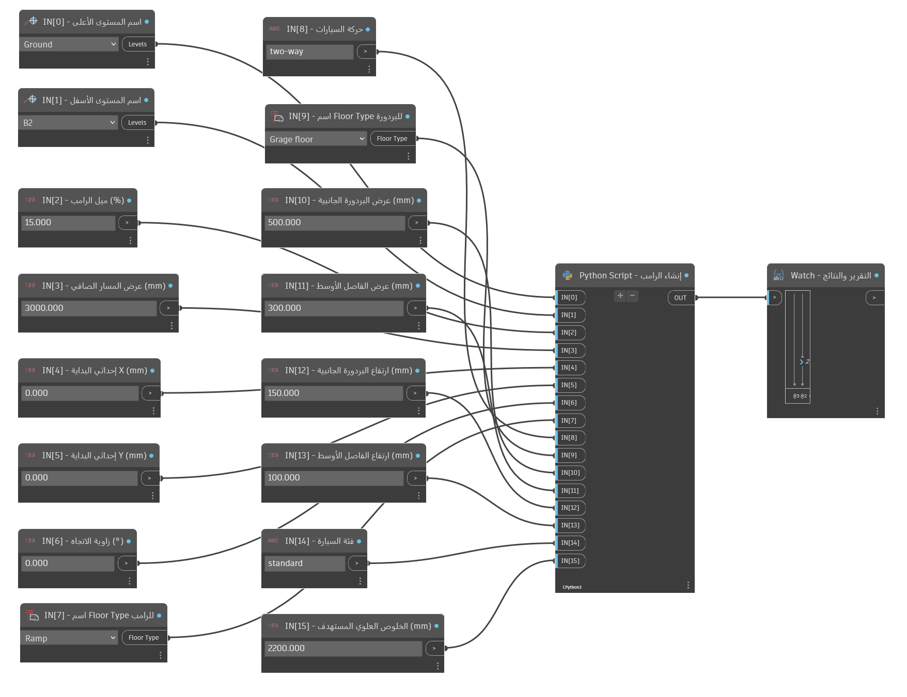

# مولّد رامب السيارات

**التصنيف:** `geometry`  
**الإصدار:** `0.1.0`  
**الحالة:** قيد التطوير  
**البيئة المستهدفة:** Revit 2025 / Dynamo 3 / CPython 3  
**محرك بايثون:** CPython 3

[English documentation](README.md)

## نظرة عامة

ينشئ هذا السكربت رامب سيارات مائلًا بين مستويين في Revit. يبني سطح الرامب من
قطعة أو أكثر من الأرضيات المائلة، ويضيف شرائط أرضية مرتفعة للبردورتين
الجانبيتين، ويضيف فاصلًا أوسطيًا في حالة المرور في الاتجاهين. تُجمع كل العناصر
المنشأة داخل Group لتسهيل تحديدها ومراجعتها.

الملف الرئيسي يحتوي على إصلاح خطأ
`Property cannot be read` باستخدام `get_Name()`. النسخة القديمة محفوظة في
[`legacy/`](legacy/README.md) للمرجع فقط، ولا تدخل في حزم الإصدارات.

> **حالة الاختبار:** لم يتم تشغيل الأداة داخل جلسة Revit فعلية. تم التحقق من
> سلامة JSON ومن توصيل المداخل الـ16 ومن تطابق كود بايثون المدمج مع
> [`script.py`](script.py). جرّبها على نسخة من المشروع دائمًا.

## المتطلبات

| المتطلب | التفاصيل |
| --- | --- |
| Revit | مستهدف Revit 2025. لم يتم التحقق منه داخل Revit بعد؛ اختبره على نسخة. |
| Dynamo | حُفظ المخطط بإصدار Dynamo `3.0.3.7597` ويستخدم CPython 3. لم يُختبر على إصدارات محددة. |
| محرك بايثون | **CPython 3 فقط.** لا يدعم IronPython 2.7. |
| حزم Dynamo | لا توجد. |
| متطلبات أخرى | وجود مستويين على الأقل ونوع أرضية واحد في المشروع. |

حقول التوافق في `script.json` فارغة عن قصد لأن الأداة لم تُختبر بعد في Revit.

## التثبيت

### الطريقة الأولى: فتح مخطط Dynamo

1. نزّل هذا المجلد أو حزمة الإصدار. راجع
   [دليل التنزيل](../../../docs/DOWNLOADING.md).
2. استخرج الملفات إلى مكان ثابت، مثل `C:\DynamoTools\car-ramp-generator`.
   لا تشغّل الملفات من داخل ملف ZIP.
3. افتح Revit 2025 ثم **Manage > Dynamo**.
4. من Dynamo اختر **File > Open** وافتح
   `CarRampGenerator_Revit2025.dyn`.
5. اختر عقدة Python وتأكد أن المحرك **CPython 3**. المخطط محفوظ بهذا المحرك
   بالفعل، وهذه خطوة تحقق فقط.
6. لا تحتاج إلى تثبيت أي حزمة.

### الطريقة الثانية: لصق الكود في عقدة Python

1. أضف عقدة **Python Script** في Dynamo واختر المحرك **CPython 3**.
2. افتح [`script.py`](script.py) وانسخ كل محتواه إلى العقدة.
3. وصّل المداخل الـ16 بالترتيب الموضح أدناه. يجب أن تحتوي العقدة على 16 مدخلًا
   بالضبط حتى تتطابق `IN[15]` وما قبلها.

الطريقة الأولى أفضل لأن المخطط يحتوي على المداخل الـ16 موصولة وموضحة، وعلى عقدة
Watch، وعلى الكود المصحح.

## الاستخدام

1. **خذ نسخة احتياطية من الملف.** استخدم **Save As** أو **File > Save a Copy**
   قبل أول تشغيل.
2. افتح `CarRampGenerator_Revit2025.dyn` داخل Dynamo.
3. اختر المستويين في `IN[0]` و`IN[1]`. الترتيب غير مهم؛ الكود يرتبهما حسب
   المنسوب ويجعل الأعلى أعلى الرامب.
4. اختر نوع الأرضية للسطح في `IN[7]`، ونوع أرضية البردورة في `IN[9]`. عند
   تشغيل `script.py` مباشرة وترك القيمة فارغة، يستخدم الكود أول نوع أرضية
   للسطح، وللبردورة يختار النوع الأقرب سمكًا إلى ارتفاع البردورة الجانبية.
5. اضبط الميل، والعرض الصافي، ونقطة البداية، وزاوية الاتجاه، ونوع المرور،
   وأبعاد البردورة، وفئة السيارة، والخلوص العلوي.
6. راجع كل القيم ثم اضغط **Run**. المخطط مضبوط على التشغيل اليدوي.
7. اقرأ التقرير في عقدة Watch. تحقق من الطول الكلي، والميل المقاس، والعرض
   الكلي، وسمك نوع الأرضية قبل اعتماد النتيجة.
8. افحص النتيجة في 3D وفي قطاع: الميل، والانتقالات، وارتفاعات البردورة،
   والخلوص أسفل الكمرات والدكتات والأبواب.
9. إذا كانت النتيجة غير صحيحة، استخدم **Undo** أو أغلق الملف دون حفظ واستعد
   النسخة الاحتياطية.

### قواعد الهندسة

- `one-way`: العرض الكلي = العرض الصافي + بردورتين جانبيتين.
- `two-way`: العرض الكلي = مسارين صافيين + بردورتين جانبيتين + فاصل أوسطي.
- `service` و`waste`: يُفرض العرض الصافي 4000 مم حتى لو كانت `IN[3]` قيمة أخرى.
- عند ميل رئيسي أعلى من 10%: يُنشئ المخطط انتقالًا علويًا بطول 3000 مم، ثم
  الرامب الرئيسي، ثم انتقالًا سفليًا بطول 3000 مم. ميل الانتقالات نصف الميل
  الرئيسي.
- نقطة البداية `IN[4]` و`IN[5]` هي أعلى نقطة في الرامب، الزاوية اليسرى،
  بإحداثيات المشروع. ينزل الرامب باتجاه الزاوية المحددة.
- `0°` باتجاه `+X`، و`90°` باتجاه `+Y`، و`180°` باتجاه `-X`، و`270°` باتجاه
  `-Y`.

## المدخلات والمخرجات

المخطط يعرض 16 مدخلًا موضحًا. القيم الافتراضية التالية هي المحفوظة في ملف
`.dyn`.

| المنفذ | المدخل | النوع | الافتراضي في المخطط | الوصف |
| --- | --- | --- | --- | --- |
| `IN[0]` | المستوى الأعلى | Level أو اسم مطابق | مطلوب | أحد المستويين. الترتيب غير مهم. |
| `IN[1]` | المستوى الأسفل | Level أو اسم مطابق | مطلوب | المستوى الآخر. يرتبهما الكود حسب المنسوب. |
| `IN[2]` | الميل الرئيسي | رقم، نسبة مئوية | `15` | أكبر من 0 ولا يزيد على 15. |
| `IN[3]` | العرض الصافي للمسار | رقم، مم | `3000` | عرض القيادة الصافي لكل مسار. يُفرض 4000 لفئتي service وwaste. |
| `IN[4]` | إحداثي X للبداية | رقم، مم | `0` | إحداثي X للزاوية اليسرى في أعلى الرامب. |
| `IN[5]` | إحداثي Y للبداية | رقم، مم | `0` | إحداثي Y للزاوية اليسرى في أعلى الرامب. |
| `IN[6]` | زاوية الاتجاه | رقم، درجة | `0` | اتجاه النزول. `0` = +X و`90` = +Y. |
| `IN[7]` | نوع أرضية الرامب | FloorType أو اسم مطابق | محدد | نوع أرضية سطح الرامب. عند تركه فارغًا يستخدم أول نوع أرضية. |
| `IN[8]` | نوع المرور | نص | `two-way` | `one-way` أو `two-way`. الافتراضي في الكود عند غياب القيمة هو `one-way`، أما الافتراضي في المخطط فهو `two-way`. |
| `IN[9]` | نوع أرضية البردورة | FloorType أو اسم مطابق | محدد | نوع أرضية شرائط البردورة. عند تركه فارغًا يختار الكود النوع الأقرب إلى ارتفاع البردورة. |
| `IN[10]` | عرض البردورة الجانبية | رقم، مم | `500` | عرض كل بردورة جانبية. |
| `IN[11]` | عرض الفاصل الأوسط | رقم، مم | `300` | عرض الفاصل، ويُستخدم في `two-way` فقط. |
| `IN[12]` | ارتفاع البردورة الجانبية | رقم، مم | `150` | ارتفاع سطح البردورة فوق سطح الرامب. |
| `IN[13]` | ارتفاع الفاصل الأوسط | رقم، مم | `100` | ارتفاع سطح الفاصل فوق سطح الرامب. |
| `IN[14]` | فئة السيارة | نص | `standard` | `standard` أو `service` أو `waste`. |
| `IN[15]` | الخلوص العلوي المستهدف | رقم، مم | `2200` | للتقارير فقط؛ لا ينشئ أو يفحص عناصر علوية. |

| المخرج | النوع | الوصف |
| --- | --- | --- |
| `OUT[0]` | Revit Group | المجموعة التي تحتوي سطح الرامب وكل شرائط البردورة. |
| `OUT[1]` | قائمة نصوص | سطور التقرير، ومنها الميل المقاس وتحذيرات سمك نوع الأرضية. |
| `OUT[2]` | `[X, Y]` | نقطة نهاية الرامب بإحداثيات المشروع بالملليمتر. |

عقدة Watch تعرض القائمة الناتجة. وسّعها إذا ظهر عنصر المجموعة فقط في البداية.

## تحذيرات وحدود

- **لم تُختبر في Revit.** تم التحقق من البنية فقط، وليس من التشغيل الفعلي.
  اختبرها على نسخة وافحص الهندسة الناتجة.
- **مستهدفة لـ Revit 2025.** تعتمد على تحميل `Floor.Create` مع سهم الميل في
  Revit API. قد ترفضها إصدارات أخرى.
- **CPython 3 فقط.** لا تستخدم IronPython 2.7.
- **البردورة عبارة عن أرضيات وليست حوائط أو درابزين.** يجب أن يكون نوع الأرضية
  المختار مناسبًا للسمك المطلوب. التقرير يطبع السمك ولا يغيّره تلقائيًا.
- **ارتفاع البردورة هو رفع لسطحها العلوي.** قد لا يطابق سمك نوع الأرضية فرق
  الارتفاع المطلوب؛ راجع القطاع.
- **تعارض عرض الفاصل الأوسط.** المسودة الأصلية تبدو بعرض 500 مم، بينما
  الافتراضي هنا 300 مم. أكّد العرض مع المصمم أو الجهة المختصة.
- **الانتقالات قد تفشل.** عند ميل أعلى من 10% يجب وجود انتقالين بطول 3000 مم
  لكل منهما. إذا كان فرق المناسيب صغيرًا فقد لا يتبقى طول موجب للرامب الرئيسي،
  فيوقف الكود العملية ويرجع العناصر المنشأة.
- **الخلوص العلوي للتقرير فقط.** لا ينشئ سقفًا ولا يقيس الكمرات أو الدكتات ولا
  يفحص التعارضات.
- **لا توجد درابزين أو حوائط أو صرف أو لوحات إرشادية أو تشطيبات.**
- **المجموعة تحتوي فقط على عناصر هذه العملية.** لا تضاف عناصر موجودة مسبقًا.
- **قد يرفض Revit اسم المجموعة** إذا كان مكررًا. تُنشأ المجموعة ويذكر التقرير
  ذلك.
- **التشغيل يدوي.** راجع المدخلات قبل كل تشغيل.
- **الوحدات:** كل المدخلات الرقمية بالملليمتر والزوايا بالدرجات. الكود يحوّل
  داخليًا إلى أقدام Revit.
- **ملفات `legacy/` غير مدعومة.** استخدم المخطط الرئيسي بدلًا منها.

## استكشاف الأخطاء

| العرض | السبب المحتمل | الحل |
| --- | --- | --- |
| `Property cannot be read` | المخطط القديم يقرأ `.Name` مباشرة | استخدم `CarRampGenerator_Revit2025.dyn` أو دالة `revit_name()` في `script.py`. |
| `IN[0]: enter an exact Level name...` | اسم المستوى غير موجود أو غير مطابق | اختر المستوى من عقدة Levels أو انسخ الاسم الحرفي من Revit. |
| `No Floor Types were found in this project.` | لا يوجد نوع أرضية | أنشئ نوع أرضية أو حمّله ثم أعد التشغيل. |
| `Main slope must be greater than 0% and no more than 15%.` | الميل صفر أو سالب أو أكبر من 15 | أدخل قيمة مثل `10` أو `15`. |
| `Height difference ... is too small for two 3000mm transitions...` | ميل عالٍ مع فرق مناسيب صغير | قلّل الميل أو اختر مستويين بفرق أكبر. |
| `could not find a valid upward planar face` | نوع الأرضية أو الرسم لم ينتج سطحًا صالحًا | جرّب نوع أرضية بسيطًا وتأكد من المستوى. |
| `measured slope ... differs from target` | Revit لم يتمكن من بناء الميل المطلوب | جرّب نوع أرضية آخر وتحقق من مناسيب المستويات. |
| `floor slopes in the wrong direction` | زاوية الاتجاه أو سلوك سهم الميل غير متوقع | راجع `IN[6]` وجرّب `0` أو `90` أو `180` أو `270`. |
| `created elements were rolled back` | خطأ داخل العملية الفرعية | اقرأ `Details` و`Traceback`؛ يجب ألا تبقى هندسة جزئية من هذه العملية. |
| المجموعة موجودة لكن الاسم غير صحيح | اسم مجموعة مكرر أو قيد من Revit | أعد تسمية نوع المجموعة؛ الهندسة موجودة. |
| لا يظهر شيء في Watch | فشل عقدة Python أو القائمة مطوية | راجع تحذيرات Dynamo ووسّع عقدة Watch. |
| `SyntaxError` أو أخطاء `.NET` | العقدة تستخدم IronPython 2.7 | غيّر المحرك إلى **CPython 3**. |
| الأبعاد كبيرة أو صغيرة 1000 مرة | إدخال بالمتر أو وحدات المشروع مختلفة | أدخل القيم بالملليمتر؛ الكود يحوّلها إلى أقدام. |
| المخطط لا يعمل تلقائيًا | وضع التشغيل يدوي | اضغط **Run** في Dynamo. |

إذا استمر الخطأ، انسخ نص الخطأ كاملًا، وخصوصًا سطور `Traceback`، مع إصدار
Revit وDynamo عند الإبلاغ عن المشكلة.

## سجل الإصدارات

راجع [CHANGELOG.md](CHANGELOG.md).

| الإصدار | التاريخ | الملخص |
| --- | --- | --- |
| `0.1.0` | 2026-10-29 | أول إضافة للمستودع: النسخة المصححة من `get_Name()`، وتوثيق عربي وإنجليزي، ومجلد `legacy/`. |

## الترخيص

جزء من Dynamo Script Library، مرخّص تحت
[رخصة MIT](../../../LICENSE). راجع
[ملاحظات الترخيص](../../../docs/LICENSING.md).
